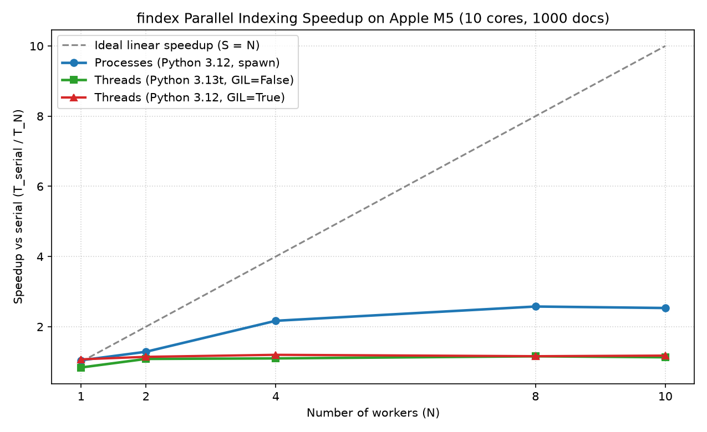

# findex — Лабораторна 4: Типи, тести, пакування і CLI

[](https://github.com/Diinamike/findex/actions/workflows/ci.yml)

Повнотекстова пошукова система `findex` (версія `0.4.0`), оформлена як інстальований Python-пакет із суворою типізацією (`pyright --strict`), 33 тестами (`pytest` + `Hypothesis`), CLI на базі `typer` та `rich`, структурованим логуванням у `stderr` і автоматизованим CI у GitHub Actions.

## 1. Статична типізація (`pyright --strict`) та архітектура

- У `pyproject.toml` увімкнено `typeCheckingMode = "strict"` — перевірка проходить із **0 помилками** та без жодного `# type: ignore`.
- `Scorer` (`src/findex/scoring.py`) реалізовано як `@runtime_checkable class Scorer(Protocol)` — `TfIdf` і `BM25` проходять перевірку сумісності структурно без успадкування.
- Потокові генератори (`iter_documents`, `tokenize`) типізовано як `Iterator[...]`, менеджер контексту `open_index` — як `Generator[Index]`.
- Варіантні рядкові параметри типізовано через `Literal["bm25", "tfidf"]` та `Literal["set", "merge"]`.

## 2. Встановлення та CLI (`typer` + `rich`)

```bash
# Встановлення пакета у глобальне середовище користувача (кладе findex у PATH)
uv tool install .

# 1. Побудова інвертованого індексу зі смугою прогресу rich
findex index data/corpus --out index.bin

# 2. Пошук із форматованою таблицею rich (або чистий JSON у stdout для перенаправлення)
findex search index.bin '(sherlock OR holmes) AND "baker street" NOT watson' --top-k 5
findex search index.bin 'sherlock' --scorer tfidf --engine merge --json > results.json

# 3. Статистика індексу та топ найчастіших термів
findex stats index.bin --top 10

# 4. Діагностичні логи в stderr (-v -> INFO, -vv -> DEBUG)
findex -v search index.bin 'sherlock'
```bash
cat << 'EOF' >> README.md

## 3. Тестування (`pytest` + `Hypothesis`) та покриття коду

Набір із **33 тестів** (`tests/test_tokenizer.py`, `tests/test_lab04.py`, фікстури у `tests/conftest.py`) перевіряє:
- токенізатор (`@pytest.mark.parametrize`, Unicode NFKC-лігатури, апострофи, дефіси, кирилиця);
- збірку індексу, dunder-методи `Mapping`, `@cached_property` та звільнення ресурсів у `open_index` при винятку;
- парсер запитів (порівняння AST-дерев `Term`, `Phrase`, `And`, `Or`, `Not` та синтаксичні помилки);
- протокол `Scorer`, `TfIdf`, `BM25` (усі 3 sanity-check із ЛР 3), серіалізацію `save` / `load` і CLI через `typer.testing.CliRunner`;
- **3 властивості Hypothesis**: `load(save(index))` відновлює ідентичний індекс; постінги завжди відсортовані за зростанням `doc_id`; `merge_postings` збігається з перетином `set`;
- повільні інтеграційні тести виділено маркером `@pytest.mark.slow`.

### Звіт покриття (`uv run pytest --cov=findex --cov-report=term-missing`)

| Модуль | Покриття | Примітка |
|--------|----------|----------|
| `src/findex/__init__.py` | **100%** | Публічний API пакета |
| `src/findex/tokenizer.py` | **100%** | Потоковий Unicode-токенізатор |
| `src/findex/utils.py` | **100%** | Декоратор `@timed` (`ParamSpec`) |
| `src/findex/index.py` | **98%** | `Index(Mapping)`, бінарний формат, `merge_postings` |
| `src/findex/scoring.py` | **92%** | Протокол `Scorer`, `TfIdf`, `BM25` |
| `src/findex/search.py` | **92%** | `SearchEngine`, `@lru_cache`, сніпети |
| `src/findex/query.py` | **89%** | Лексер, рекурсивний спуск, AST-вузли |
| `src/findex/cli.py` | **88%** | Команди `index`, `search`, `stats`, обробка помилок |
| `src/findex/stats.py` | **0%** | Допоміжний бенчмарк Lazy vs Eager з ЛР 1 (навмисно поза CLI-покриттям) |
| **Загальне покриття** | **87%** | **33 passed (603 / 696 statements)** |

**Що навмисно залишено поза покриттям (13%):**
1. Модуль `src/findex/stats.py` (43 рядки) — бенчмарк порівняння лінивого та жадібного конвеєрів із Лабораторної 1, який не входить до рантайму CLI `findex`.
2. Низькорівневі гілки помилок файлової системи (`OSError` / `PermissionError` при читанні битих файлів у `corpus.py` та `cli.py`) та захисні `NotImplementedError` у базовому класі `QueryNode`.

---

## 4. Лабораторна 5: Конкурентність і GIL (`build_partial` + `merge`)

### Апаратна конфігурація та корпус
- **Процесор:** Apple M5 (10 ядер: продуктивні P-ядра + енергоефективні E-ядра, `os.cpu_count() == 10`).
- **Корпус:** 1 000 текстових книг у `data/corpus` (435 397 унікальних термів з урахуванням позицій).
- **Типовий виконавець CLI:** `--executor processes` (оскільки на багатоядерному процесорі процеси дають максимальне прискорення).

### Результати бенчмарку (медіана з 3 прогонів)

| Режим виконання | Воркери ($N$) | Wall time (с) | CPU time батьк. (с) | Пік RSS (МБ) | Час merge (мс) | Прискорення |
| :--- | :---: | :---: | :---: | :---: | :---: | :---: |
| `serial` (Python 3.12) | 1 | 29.82 | 28.75 | 3465.8 | 1196.5 | **1.00×** |
| `threads` (Python 3.12, GIL=True) | 1 | 27.88 | 27.27 | 3521.3 | 1239.8 | 1.07× |
| `threads` (Python 3.12, GIL=True) | 2 | 26.12 | 25.85 | 3578.3 | 1129.8 | 1.14× |
| `threads` (Python 3.12, GIL=True) | 4 | 24.86 | 24.88 | 3578.3 | 839.4 | 1.20× |
| `threads` (Python 3.12, GIL=True) | 8 | 25.71 | 25.99 | 3635.1 | 921.3 | 1.16× |
| `threads` (Python 3.12, GIL=True) | 10 | 25.35 | 25.70 | 3635.1 | 690.7 | 1.18× |
| `processes` (Python 3.12, spawn) | 1 | 28.60 | 28.14 | 3641.9 | 1238.7 | 1.04× |
| `processes` (Python 3.12, spawn) | 2 | 23.19 | 5.35 | 3641.9 | 1036.1 | 1.29× |
| `processes` (Python 3.12, spawn) | 4 | 13.75 | 4.02 | 3641.9 | 1096.5 | 2.17× |
| `processes` (Python 3.12, spawn) | 8 | **11.58** | 5.16 | 3641.9 | 857.8 | **2.58×** |
| `processes` (Python 3.12, spawn) | 10 | 11.77 | 5.39 | 3641.9 | 1034.5 | 2.53× |
| `threads` (Python 3.13t, GIL=False) | 1 | 35.61 | 34.97 | 4299.9 | 803.6 | 0.84× |
| `threads` (Python 3.13t, GIL=False) | 2 | 27.56 | 41.54 | 4330.6 | 668.0 | 1.08× |
| `threads` (Python 3.13t, GIL=False) | 4 | 27.18 | 65.94 | 4330.6 | 738.6 | 1.10× |
| `threads` (Python 3.13t, GIL=False) | 8 | 25.78 | 123.95 | 4330.6 | 693.6 | 1.16× |
| `threads` (Python 3.13t, GIL=False) | 10 | 26.41 | 133.60 | 4330.6 | 1008.5 | 1.13× |



### Аналіз результатів: GIL, процеси, закон Амдала та Python 3.13t

1. **Чому потоки під GIL (`threads` у Python 3.12) не прискорили індексацію:**
   Індексація текстів (Unicode-нормалізація NFKC, регулярні вирази, формування словників постінгів і кортежів позицій) є **CPU-bound** задачею у чистому Python. Оскільки **Global Interpreter Lock (GIL)** дозволяє виконувати байткод Python лише одному потоку в кожен момент часу, 10 потоків по черзі борються за один GIL на одному ядрі, даючи лише ~1.18× за рахунок перекриття короткого дискового читання.

2. **Чому процеси (`processes`) прискорили індексацію і чим це оплачено:**
   У `ProcessPoolExecutor` кожен воркер має власний інтерпретатор Python і власний GIL, тому 8 процесів одночасно токенізують різні чанки корпусу на фізичних ядрах Apple M5, скорочуючи `wall time` з **29.82 с до 11.58 с (2.58×)**.
   Ціна цього прискорення:
   - **Серіалізація `pickle`:** кожен воркер повертає у батьківський процес `PartialIndex` (сотні тисяч рядків і кортежів позицій), на десеріалізацію яких батьківський процес витрачає ~4–5 с `CPU time` і додатково ~176 МБ `RSS` (плюс окремі адресні простори дочірніх процесів).
   - **Запуск `spawn` на macOS:** створення нових процесів без `fork` потребує ініціалізації інтерпретатора у кожному воркері.

3. **Де у часі `merge` та `pickle` проявляється закон Амдала:**
   За законом Амдала $S(N) = \frac{1}{(1 - p) + \frac{p}{N}}$, максимальне прискорення обмежене послідовною часткою програми $(1 - p)$, яка не розпаралелюється. У нашому конвеєрі послідовна фаза — це отримання `PartialIndex` через `pickle` у батьківському процесі та однопотокове злиття `merge_partial_indexes` (**~0.86–1.10 с**), а також нерівномірність розмірів книг і різниця між P- та E-ядрами Apple M5. Через це крива прискорення насичується на рівні **2.58×** при $N = 8$ і не зростає далі при $N = 10$.

4. **Що змінилося у free-threaded Python 3.13t (`sys._is_gil_enabled() == False`) і гонитва потоків:**
   На `Python 3.13.18t` без GIL сумарний `CPU time` при 10 потоках зріс з 34.97 с до **133.60 с** — це підтверджує, що потоки дійсно виконуються паралельно на багатьох ядрах. Проте `wall time` залишився ~25.78 с, оскільки інтенсивне створення мільйонів об'єктів `str`/`tuple` у 10 потоках викликає конкуренцію за внутрішній алокатор пам'яті, атомарний підрахунок посилань (biased reference counting) та per-object блокування словників, а стартовий `RSS` зріс до 4.33 ГБ.
   Крім того, вимкнення GIL відкриває **гонитву даних (race condition)** на неатомарних операціях *read-modify-write*: у нашому експерименті на `3.13t` (`sys._is_gil_enabled() == False`) 8 потоків виконували 400 000 інкрементів спільного списку `shared[0]` без блокування, і через відсутність GIL було втрачено **332 065 оновлень** (`Actual: 67935`). У `findex` ця проблема вирішена архітектурно за шаблоном **Map-Reduce**: воркери не мають спільного змінюваного стану, кожен будує ізольований `PartialIndex` зі своїм заздалегідь виділеним діапазоном `doc_id`, а фінальний `merge` відбувається детерміновано після завершення всіх воркерів.
